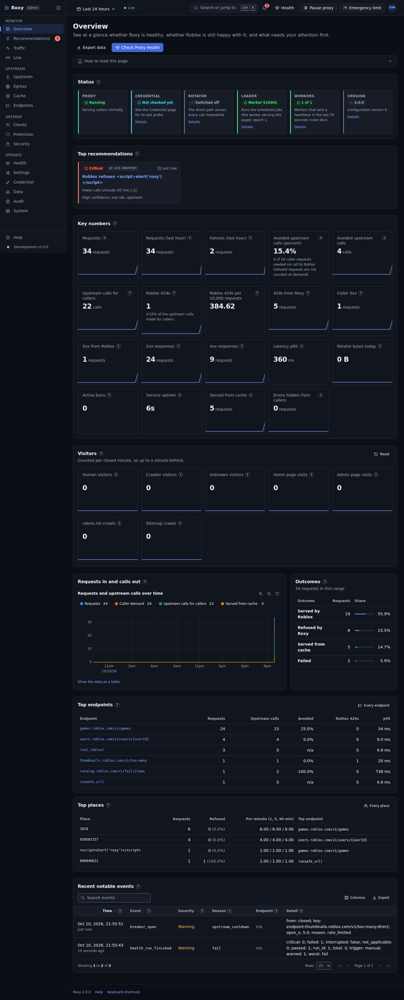

# Roxy

Roxy v2 is a Roblox web API proxy that is safe for its operator, kind to Roblox and fully observable. The full
README is written in P12; until then, these are the guides:

- [`docs/USER_GUIDE.md`](docs/USER_GUIDE.md): for game developers who call Roxy (also served at `/docs`).
- [`docs/ADMIN_GUIDE.md`](docs/ADMIN_GUIDE.md): for the owner who runs Roxy, one chapter per dashboard page (also on
  the dashboard's Help page; being written).
- [`docs/ARCHITECTURE.md`](docs/ARCHITECTURE.md): the process model, the request flow, storage and jobs, deploys
  and memory, and the design decisions behind them.
- [`docs/SECURITY.md`](docs/SECURITY.md): the threats, the hard constraints C1 to C7 and the tests that prove them.
- [`docs/RUNBOOKS.md`](docs/RUNBOOKS.md): what to do when an alert or a health check fires.
- [`docs/LEARNING_PATH.md`](docs/LEARNING_PATH.md): the guided reading order through the code, with exercises.
- [`docs/SETTINGS.md`](docs/SETTINGS.md): every setting (generated from the catalog).
- [`docs/PERFORMANCE.md`](docs/PERFORMANCE.md): the load harness, its results and how to run it again.
- [`deploy/README.md`](deploy/README.md): the operations files and the server layout.
- [`CHANGES.md`](CHANGES.md): what changed from v1, and why.

## The dashboard

The admin dashboard lives at `/admin` (sign in with your password and your authenticator app). It has 18 pages in
four groups; every page says what it is for in its first line and explains itself in its "How to read this page"
panel. The screenshots below are whole pages in the dark theme at 1440 by 900, taken from a test dashboard with
seeded traffic (which deliberately includes hostile text such as `<script>` tags, shown as plain text).

| Page | What it is for | Screenshot |
|---|---|---|
| **Monitor** | | |
| Overview | See at a glance whether Roxy is healthy, whether Roblox is still happy with it, and what needs your attention first. | [dark](docs/screenshots/overview.png), [light](docs/screenshots/overview-light.png) |
| Recommendations | Review what Roxy found in its own numbers and decide which suggested changes to preview, apply, snooze or dismiss. | [dark](docs/screenshots/recommendations.png) |
| Traffic | Follow how much traffic Roxy handles, how it ends, how fast it is answered and how it changes from week to week. | [dark](docs/screenshots/traffic.png) |
| Live | Watch requests as Roxy handles them, filter them, and open one to see its full trace. | [dark](docs/screenshots/live.png) |
| **Upstream** | | |
| Upstream | See how Roblox is answering Roxy and tune the pacing that keeps Roxy under Roblox's rate limits. | [dark](docs/screenshots/upstream.png) |
| Egress | See how many bytes leave through each path, how much of the rotator quota is used, and whether the rotator is healthy. | [dark](docs/screenshots/egress.png) |
| Cache | See how many requests the cache answers without asking Roblox, tune how long answers are kept, and inspect or purge stored answers. | [dark](docs/screenshots/cache.png) |
| Endpoints | Find the endpoints callers use most and see, for each one, its volume, cache hit ratio, Roblox 429s, latency and the rules that apply to it. | [dark](docs/screenshots/endpoints.png) |
| **Defense** | | |
| Clients | See who calls Roxy, by experience (place) and by address, how fast, how often they are refused, and act on one of them. | [dark](docs/screenshots/clients.png) |
| Protection | Decide which callers Roxy turns away and how: limits, bans, filters, spam detectors and the tarpit. | [dark](docs/screenshots/protection.png), [light](docs/screenshots/protection-light.png) |
| Security | See who signs in, who probes Roxy for weaknesses, what clients send, and manage your sessions, devices and second factors. | [dark](docs/screenshots/security.png) |
| **Operate** | | |
| Health | Run Check Proxy Health, watch each check finish, and compare the result with earlier runs. | [dark](docs/screenshots/health.png) |
| Settings | Find and change any runtime setting, see what changed and why, and export or import your changes. | [dark](docs/screenshots/settings.png) |
| Credential | Check the one Roblox account Roxy may use, what it is used for, and replace it safely when needed. | [dark](docs/screenshots/credential.png) |
| Data | See what Roxy stores and for how long, reset statistics you no longer want, and take backups and exports. | [dark](docs/screenshots/data.png) |
| Audit | Look up who changed what, when and why, see exactly what each change did, and put a setting back the way it was. | [dark](docs/screenshots/audit.png) |
| System | Check the worker processes, the leader and its jobs, the metrics pipeline, the error log and the versions Roxy runs. | [dark](docs/screenshots/system.png) |
| Help | Read the admin guide, look up a term, and learn the keyboard shortcuts. | [dark](docs/screenshots/help.png) |

The screenshots are taken by a browser test, so they can be taken again whenever a page changes:
`ROXY_SCREENSHOTS=1 .venv/bin/python -m pytest tests/e2e/test_docs_screenshots.py` rewrites `docs/screenshots/`.
